# AWS Cloud Infrastructure Project

A custom AWS network built from scratch: a VPC with public and private subnets, two EC2 instances behind a public load balancer, IAM-based access control, and monitoring/audit logging with CloudWatch and CloudTrail.

> The AWS resources are torn down after testing to avoid cost. The [`screenshots`](./screenshots) folder shows the working setup.

---

## Architecture

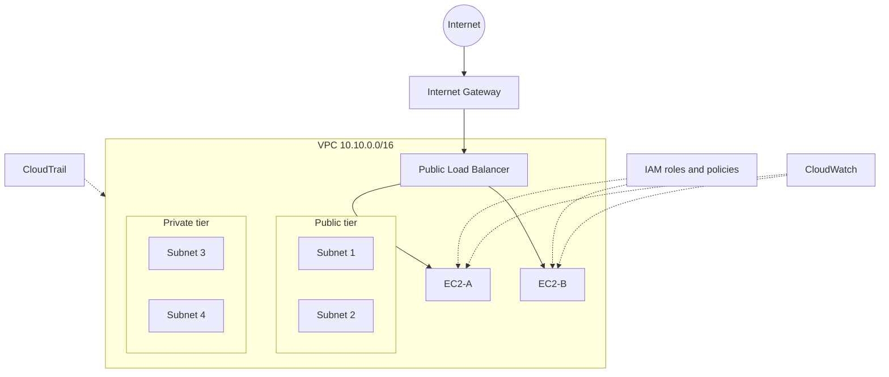

<!-- TODO: Adjust the diagram so EC2-A / EC2-B sit in the subnets you actually used. -->

---

## What I Built

- **Custom VPC** with CIDR `10.10.0.0/16`
- **Four subnets** across public and private tiers, with route tables controlling traffic flow
- **Two EC2 instances (EC2-A, EC2-B)** behind a public **Load Balancer** for distributed request handling
- **IAM roles and policies** for access control
- **CloudWatch** for monitoring and **CloudTrail** for audit logging

---

## Network Design

| Component | Details |
|---|---|
| VPC | `10.10.0.0/16` |
| Subnet 1 | `<CIDR>` · `<AZ>` · `<Public/Private>` |
| Subnet 2 | `<CIDR>` · `<AZ>` · `<Public/Private>` |
| Subnet 3 | `<CIDR>` · `<AZ>` · `<Public/Private>` |
| Subnet 4 | `<CIDR>` · `<AZ>` · `<Public/Private>` |
| Internet Gateway | `<name>` |
| Route tables | `<which subnets use which routes>` |
| NAT Gateway | `<used or not>` |

<!-- TODO: Fill every <placeholder> from your AWS console. If you are not sure, delete the row instead of guessing. -->

---

## Compute and Load Balancing

| Item | Details |
|---|---|
| EC2-A | `<instance type>` · `<subnet>` · `<AMI>` |
| EC2-B | `<instance type>` · `<subnet>` · `<AMI>` |
| Load balancer | `<ALB or NLB>`, internet-facing |
| Target group | `<name>` · health check `<path/port>` |
| Security groups | `<inbound/outbound rules>` |

**Traffic flow:** user → Internet Gateway → Load Balancer → healthy EC2 instance (A or B).

---

## Security and Monitoring

- **IAM:** `<role name>` with `<policies>`, following least privilege
- **CloudWatch:** `<metrics / alarms / logs enabled>`
- **CloudTrail:** `<trail name>`, records API activity for auditing

---

## Screenshots

### VPC and subnets
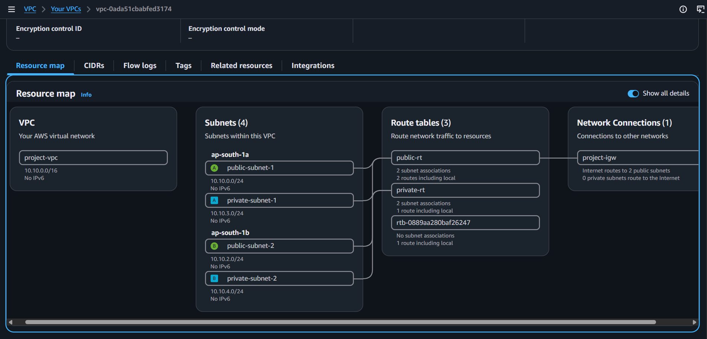
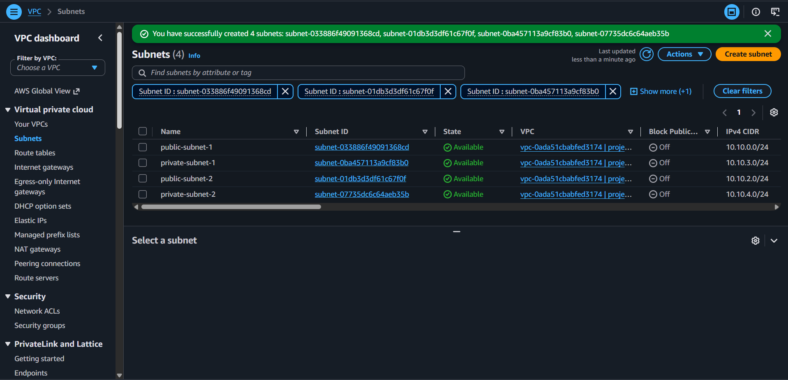

### Routing
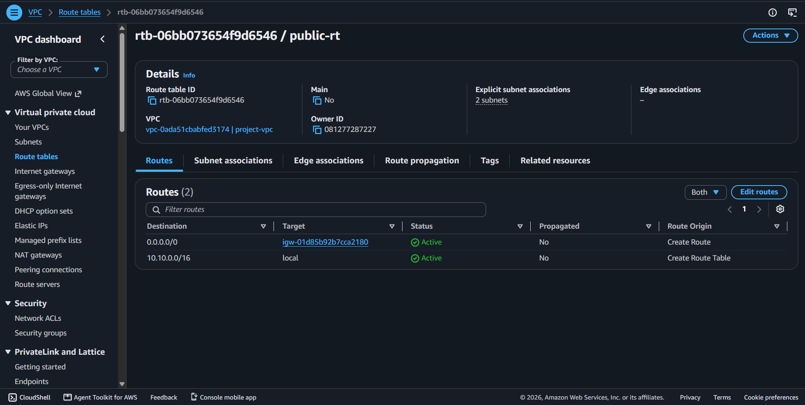
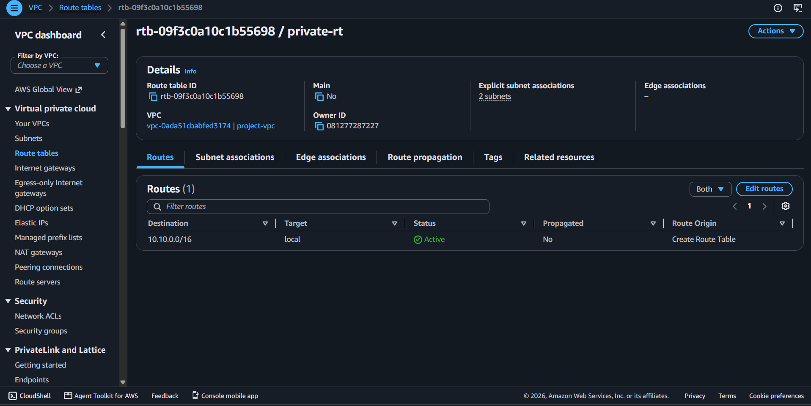
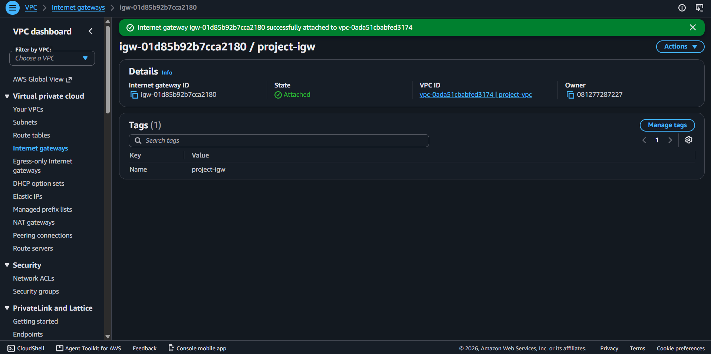

### Security groups
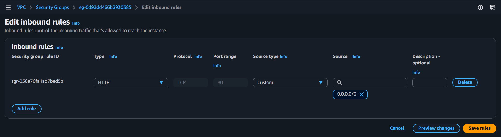
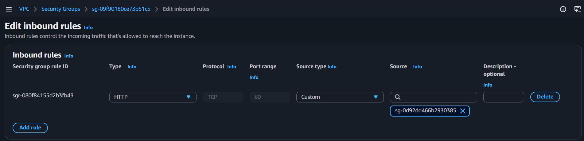

### Compute and load balancing
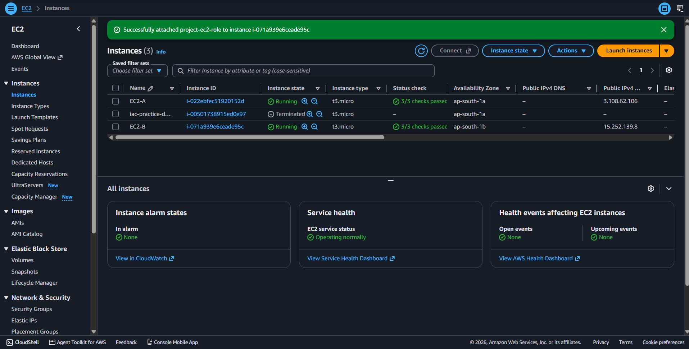
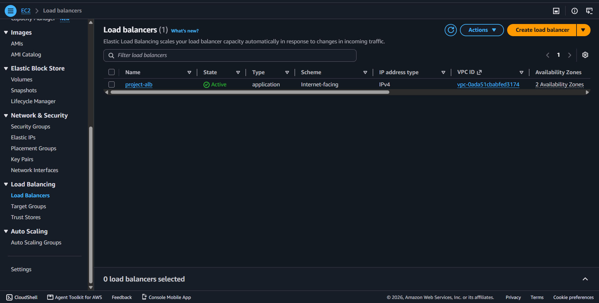
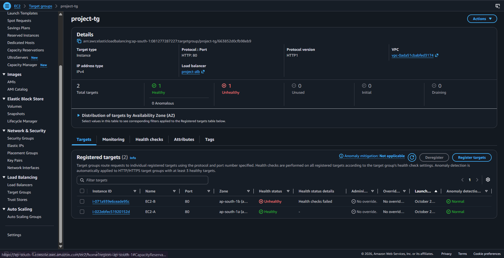
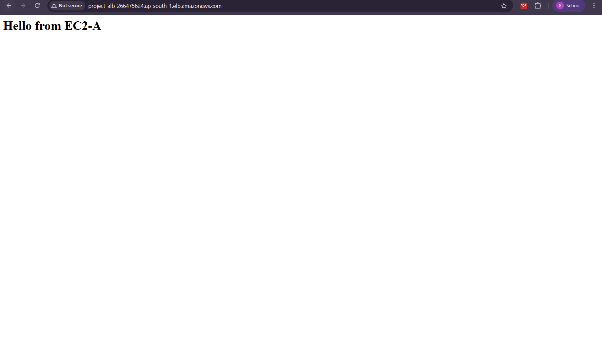

### Access control
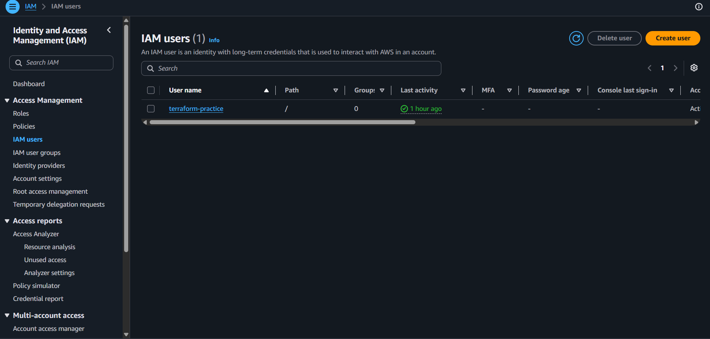

### Monitoring and audit
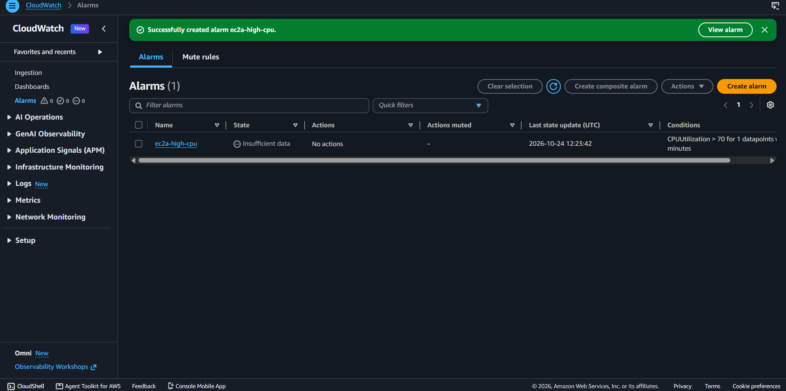
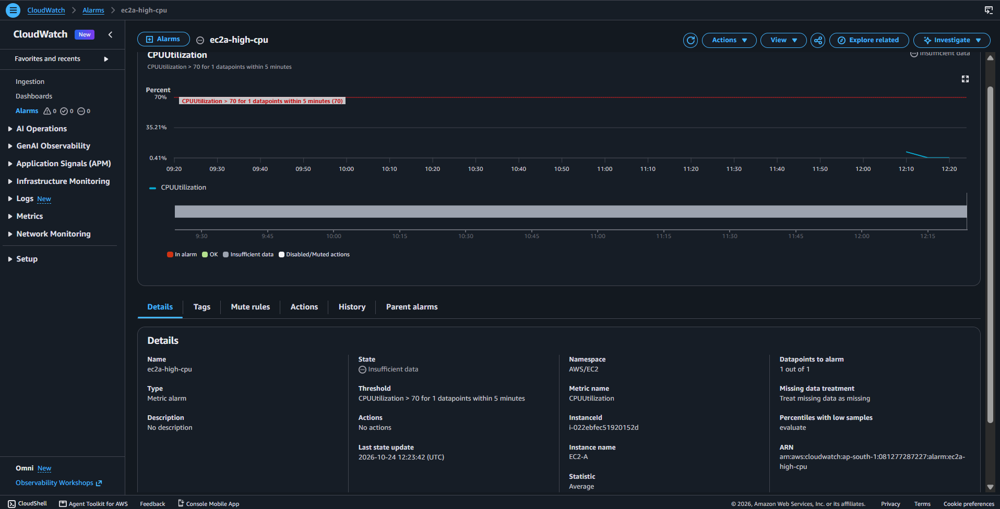
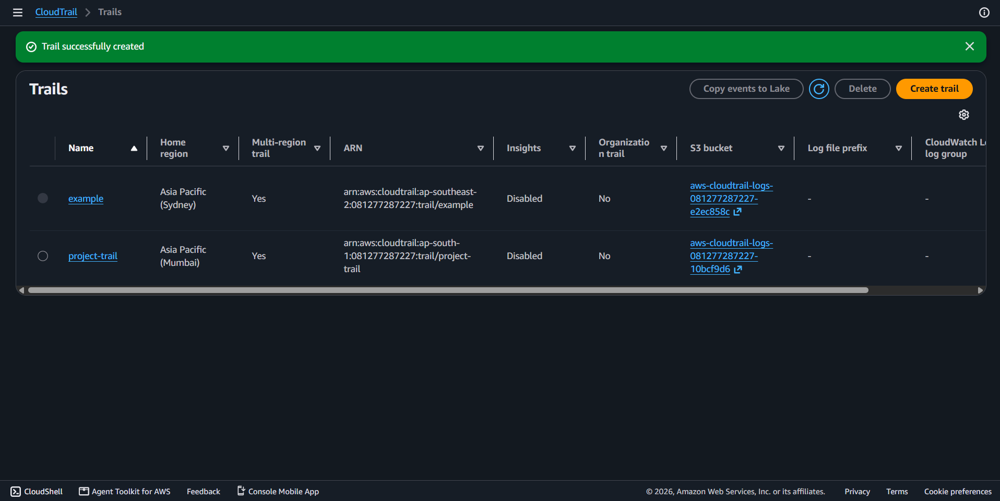
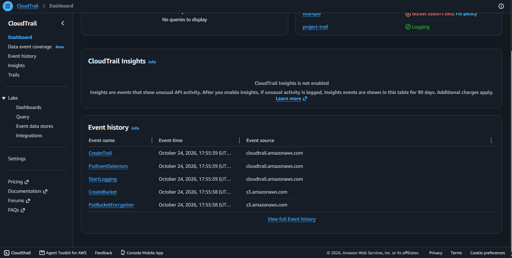

## Step-by-step Setup

See [`docs/setup-steps.md`](./docs/setup-steps.md).

---

## What I Learned

- How VPCs, subnets and route tables separate public and private resources
- How a load balancer distributes traffic and uses health checks
- Why IAM least privilege matters
- The difference between monitoring (CloudWatch) and auditing (CloudTrail)

## Possible Improvements

- Auto Scaling Group for automatic scaling
- HTTPS with ACM certificates
- Recreate the same setup with Terraform (see my Terraform project)
